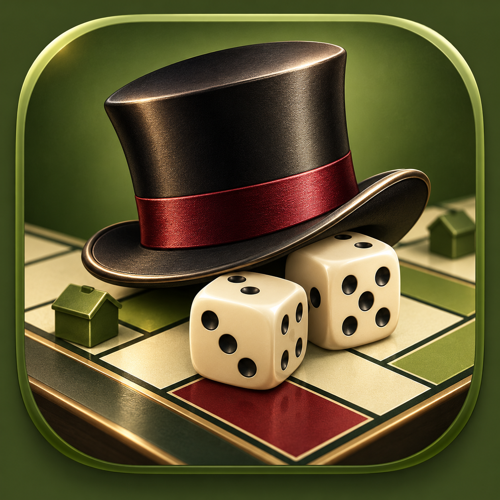

# 🎲 Monopoly – Friends Edition

**A little board game. A lot of memories.**

🎉 **Official final release:** [Monopoly – Friends Edition v1.0.0](https://github.com/macpan-codes/BoardGame/releases/tag/v1.0.0)

A Monopoly-inspired 2D board game for Android, made in Unity 6 by **Macpan / Macverse**, with ideas, creativity, and encouragement from friends.

> **Project status: Completed personal edition — October 28, 2026.**  
> This project is preserved as a keepsake. No further development is planned.

## The game

Take turns rolling two dice, travelling around the board, buying properties, collecting rent, and building a property empire. Make strategic trades, manage your cash, and try to be the last player standing — or the wealthiest when a match ends.

### Features

- **2–6 local players**, sharing one Android device
- Custom player names and colors; play with friends or against **AI bots**
- A 40-space board, animated tokens, and arrangements that keep multiple players visible on the same tile
- Property purchases, ownership, rent, property groups, **houses and hotels**
- Property and cash **trading** between players
- **Chance** and **Community Chest** cards with special events
- Railways, utilities, taxes, jail, mortgages, debt recovery, and bankruptcy
- Match-ending rules, voting, standings, and final results
- Background music, gameplay sound effects, and audio settings
- An interactive **Credits** section celebrating the people behind the game
- A themed **Multiplayer — Under Development** page

**Important:** Local multiplayer means multiple people playing on **one device**. Online and Bluetooth multiplayer are **not implemented**.

## How to play

1. Install the Android APK from a copy shared by the developer.
2. Tap **PLAY LOCAL**.
3. Choose 2–6 participants, enter player names, choose colors, and assign bots where desired.
4. Take turns rolling the dice, managing properties, upgrading, and trading.
5. Keep an eye on your money and compete to win.

Don't miss **CREDITS** in the main menu: each contributor has a card with their own title, role, fun fact, and achievement.

## The people behind the board

| Contributor | Credit |
| --- | --- |
| **ChatGPT** | The Brain Behind the Curtain — technical brainstorming and development assistance |
| **Gemini** | The Imagination Machine — creative concepts and ideas |
| **Macpan** | The Master Linker — connecting and building the game |
| **Tahsan** | The Property Architect — creative input and property designs |
| **Purna** | The Idea Generator — ideas |
| **Turjo** | The Royal Advisor — suggestions |
| **Toha** | Chief Motivation Officer — motivation and friendship |

See the **in-game Credits** for the playful details and dedications.

## Project information

- **Engine:** Unity 6 (project editor version: 6000.0.81f1)
- **Platform:** Android APK
- **Mode:** Offline, turn-based, local play and bots
- **Main scenes:** MainMenu, GameSetup, MainScene, Credits, MultiplayerComingSoon
- **Source:** This repository contains the Unity project. To open it, use the matching Unity Editor version.
- **APK:** The final APK was built separately. The public [v1.0.0 release](https://github.com/macpan-codes/BoardGame/releases/tag/v1.0.0) is published, but its APK download is pending attachment.

This is a personal, fan-made project inspired by classic property-trading board games; it is not an official Monopoly product.

---

## ❤️ A final note

This game started with ideas and grew through experiments, late-night fixes, jokes, and plenty of questionable financial decisions.

It was made to be played together — and to remember the people who helped make it happen.

**The development ends here. The memories stay.**

*— Macpan, October 2026*
